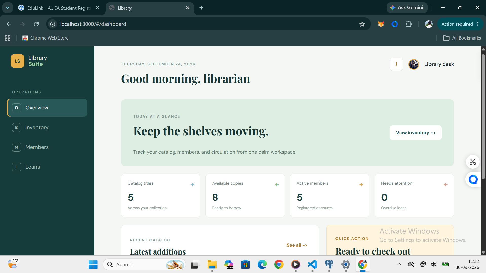
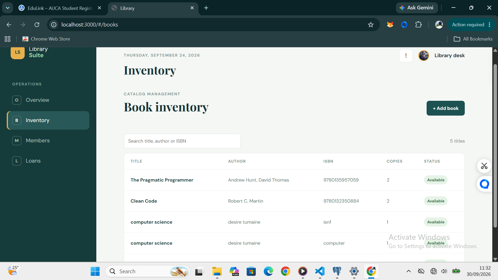
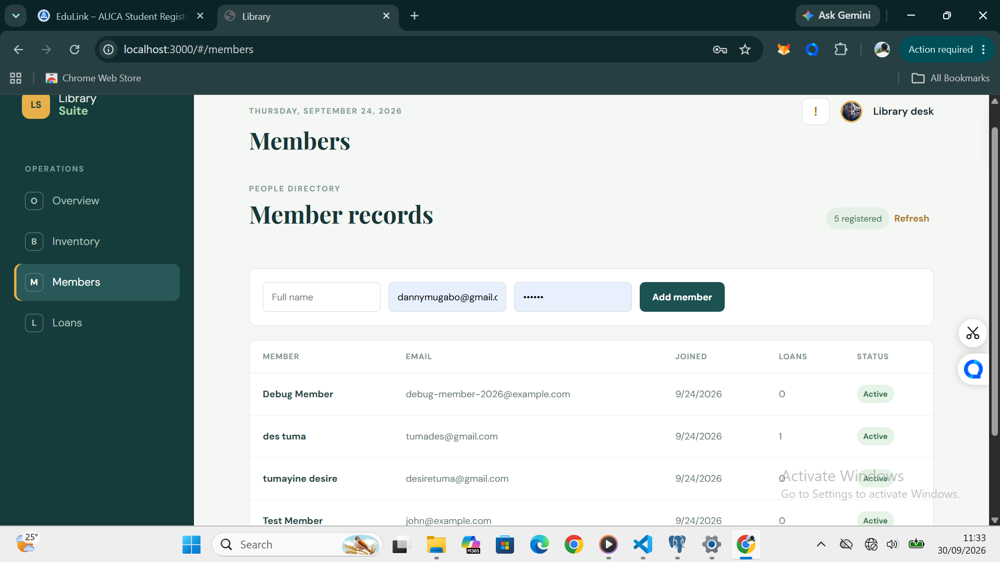
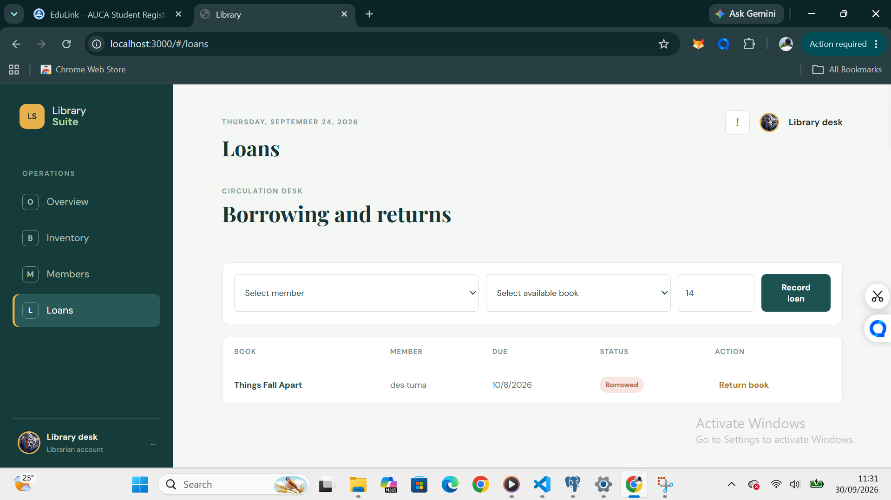
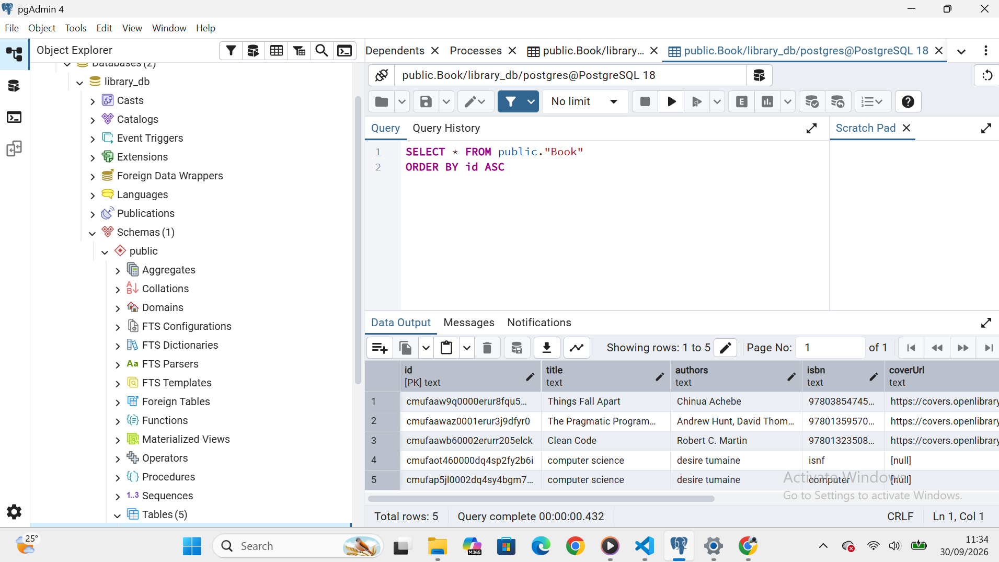
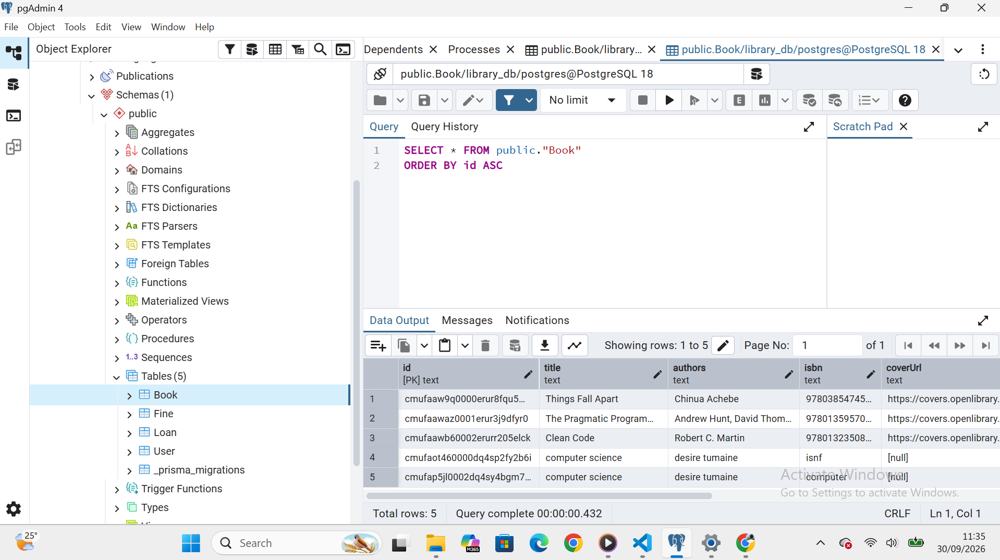

# Library Suite

Library Suite is a library management platform for maintaining a book catalogue, managing members, and tracking loans and returns. It uses PostgreSQL for persistent data and Prisma to manage the database schema.

## Screenshots

### Frontend

#### Overview


#### Book inventory


#### Members


#### Loans


### Database

#### PostgreSQL in pgAdmin


#### Database records in pgAdmin


## Features

- Dashboard summary of catalogue titles, available copies, members, and recent additions.
- Add and search books by title, author, or ISBN.
- Register members and review member records.
- Create loans, record returns, and calculate overdue fines at $0.50 per day.
- PostgreSQL persistence with Prisma models for users, books, loans, and fines.

## Technology

- Frontend: React 18 and Vite
- Backend: Node.js and Express
- Database: PostgreSQL 14
- ORM and migrations: Prisma 5
- Local database: Docker Compose

## Run Locally

### Prerequisites

- Node.js 18 or newer and npm
- Docker Desktop, or a PostgreSQL server you can connect to

### Start PostgreSQL

From the project root, start the database service:

```powershell
docker compose up -d db
```

The Compose database is available at `localhost:5432` with the development database name `library_db`.

### Configure and migrate the database

In PowerShell, copy the example environment file, then install the backend dependencies and apply the Prisma migration:

```powershell
Copy-Item backend/.env.example backend/.env
Set-Location backend
npm install
npm run prisma:generate
npx prisma migrate deploy
npm run dev
```

The API starts at `http://localhost:4000`. Keep this terminal running.

### Start the frontend

In a second terminal from the project root:

```powershell
Set-Location frontend
npm install
npm run dev
```

Open `http://localhost:3000` to use the app. The Vite development server proxies `/api` requests to the backend.

## API

- `GET /health` - API health check
- `/api/books` - list and add books
- `/api/members` - list members
- `/api/auth/register` - register a member
- `/api/loans` - list loans, borrow books, and record returns

## Database Models

- `User` stores member and librarian accounts.
- `Book` stores catalogue details and available copy counts.
- `Loan` associates a member with a book and its due and return dates.
- `Fine` records an overdue fine for a loan.

The initial schema migration is in `backend/prisma/migrations/`. For deployments, replace the development `JWT_SECRET` with a secure secret and configure `DATABASE_URL` for your PostgreSQL instance.
